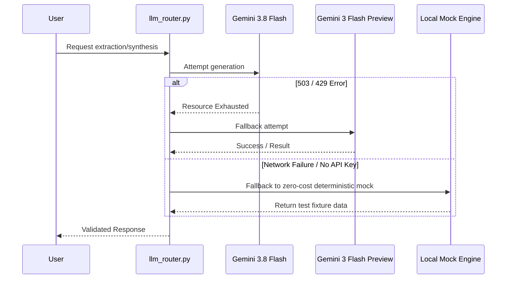

# 🔍 PROVENANCE Engine

<div align="center">
  
  
  
  
</div>

<br/>

> **PROVENANCE** is an autonomous, multi-agent deep research and OSINT system. It cuts through noise, hallucinations, and echo chambers to produce **auditable dossiers** backed by a cryptographically verifiable claim ledger, exact offset grounding, and calibrated confidence scores.

---

## ⚡ Why Provenance?

In a world overflowing with AI hallucinations and unverified claims, **trust is the ultimate currency**. Provenance doesn't just generate reports—it *investigates*, *cross-references*, and *proves* every single assertion it makes. 

- 🧠 **Dual-Tier Intelligence:** Uses blazing-fast `Gemini 3.8 Flash` for heavy lifting (harvesting, extraction) and resilient fallback routing.
- 🛡️ **Ironclad Security:** Built-in SSRF protection, DNS rebinding guards, and memory taint tracking.
- 🎯 **Verbatim Grounding:** If the system makes a claim, it must point to the *exact character offset* in the original source document. Zero hallucinations allowed.
- 🔗 **Sybil Resistance:** Automatically collapses syndicated or copied articles into a single evidence weight using SimHash clustering.

---

## 🏗️ System Architecture

### Multi-Agent LangGraph Workflow

The core of Provenance is a rigorous, cyclic investigation graph that ensures no claim is published without strict validation.

```mermaid
flowchart TD
    A([User Query & Target URLs]) -->|Initiate| B[Harvesting Node]
    B --> C[Ingestion & Parsing]
    
    subgraph "Trust Boundary"
    C -->|Sanitized Docs| D[Human Review / Oversight]
    D -.->|Approve| E[Extraction Node]
    D -.->|Reject| X([Terminate])
    E -->|Raw Claims| F[Sybil Clustering Engine]
    F -->|Independent Sources| G[Validation & Grounding]
    G -->|Offset Checks| H{Ledger Valid?}
    end
    
    H -- No -->|Re-Extract| E
    H -- Yes --> I[Dossier Synthesis]
    I --> J([Final PDF / Markdown Dossier])
    
    classDef secure fill:#e8f4f8,stroke:#2b6cb0,stroke-width:2px;
    class C,E,F,G,H secure;
```

### Dual-Tier LLM Routing & Fallback

To ensure maximum uptime and cost-efficiency while navigating stringent rate limits (e.g., HTTP 429 / 503), the engine employs a resilient fallback strategy.



---

## 🚀 Getting Started

Provenance is fully containerized, bundling the core engine, a Streamlit UI, a SearxNG instance for private search, and a Caddy reverse proxy.

### Prerequisites
- Docker & Docker Compose
- A Google GenAI API Key (`GOOGLE_API_KEY`)

### Quickstart

1. **Clone the repository:**
   ```bash
   git clone https://github.com/SiddhamShah972/Provinence.git
   cd Provinence
   ```

2. **Configure your environment:**
   Create a `.env` file in the root directory:
   ```env
   GOOGLE_API_KEY=AIzaSy...your_key_here...
   ```

3. **Deploy the stack:**
   ```bash
   docker compose up -d --build
   ```

4. **Access the UI:**
   Open your browser and navigate to the application (default credentials managed via Caddyfile Basic Auth).

### Running the Test Suite
Ensure the engine is running flawlessly by executing the acceptance tests:
```bash
docker compose exec provenance-app python -m pytest tests/test_acceptance.py -v
```

---

## 📂 Repository Structure

```text
provenance/
├── config/              # Tier configs, blocked domains, system settings
├── provenance_engine/   
│   ├── llm_router.py    # Dual-tier resilient routing
│   ├── net/             # SSRF-proof async network clients
│   ├── intake/          # File sanitization & magic-byte routing
│   ├── extract/         # Verbatim offset-grounded extractors
│   ├── trust/           # SimHash clustering, calibration, & taint tracking
│   └── graph/           # Multi-agent LangGraph workflows
├── ui/                  # Streamlit frontend application
├── tests/               # 100% deterministic acceptance suite
└── docker-compose.yml   # Orchestration for App, SearxNG, and Caddy
```

---

## 📚 Documentation
- 📐 [Architectural Plan](docs/PLAN.md)
- 🔒 [Security Model](docs/SECURITY.md)
- 🚧 [Known Gaps & Roadmap](docs/KNOWN_GAPS.md)

<div align="center">
  <i>Engineered for truth, built for scale.</i>
</div>
